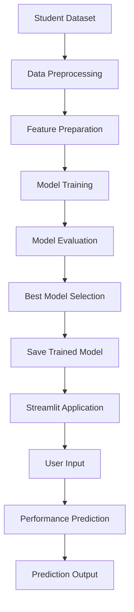

# 🎓 AI-Based Student Performance Prediction System

<p align="center">
  <b>Machine Learning Powered Student Performance Analysis & Prediction</b>
</p>

<p align="center">
  An intelligent data-driven application designed to analyze student-related factors and predict academic performance using Machine Learning.
</p>

<p align="center">
  
  
  
  
</p>

---

## 📌 Overview

The **AI-Based Student Performance Prediction System** is a machine learning project that uses student-related data and academic influencing factors to predict student performance.

The project aims to transform educational data into meaningful insights using data preprocessing, model training, evaluation, and prediction. It provides an interactive interface where users can input relevant student information and obtain model-generated predictions.

The project demonstrates the practical application of Artificial Intelligence, Machine Learning, Python, and data analytics in the education domain.

---

## ✨ Features

- 🎯 **Student Performance Prediction** — Predict academic performance using trained machine learning models.
- 📊 **Data-Driven Analysis** — Analyze student-related factors that may influence academic outcomes.
- 🧹 **Data Preprocessing** — Prepare and transform input data before model training and prediction.
- 🤖 **Multiple ML Models** — Train and evaluate multiple machine learning models.
- 🏆 **Best Model Selection** — Save the selected best-performing model for prediction.
- 📈 **Model Evaluation** — Evaluate models using performance metrics.
- 🖥️ **Interactive Web Application** — User-friendly interface powered by Streamlit.
- 🔄 **Reusable ML Pipeline** — Organized preprocessing, training, and prediction modules.
- 🧪 **Testing** — Includes pipeline testing to verify project functionality.

---

## 🛠️ Tech Stack

| Technology | Purpose |
|---|---|
| Python | Core programming language |
| Pandas | Data processing and manipulation |
| NumPy | Numerical computations |
| Scikit-learn | Machine learning and model evaluation |
| Streamlit | Interactive web application |
| Joblib | Model serialization and loading |
| Matplotlib / Seaborn | Data visualization *(if used)* |

---

## 🧠 Machine Learning Workflow



---

## 📂 Project Structure

```text
AI-Based-Student-Performance-Prediction-System/
│
├── app.py                       # Streamlit application
├── requirements.txt              # Project dependencies
├── README.md                    # Project documentation
│
├── data/
│   └── StudentPerformanceFactors.csv
│
├── models/
│   ├── all_models.joblib        # Trained ML models
│   ├── best_model.joblib        # Selected best model
│   └── metrics.json             # Model evaluation metrics
│
├── src/
│   ├── __init__.py
│   ├── preprocess.py             # Data preprocessing
│   ├── train.py                  # Model training
│   └── predict.py                # Prediction logic
│
└── tests/
    └── test_pipeline.py           # Pipeline tests
```

---

## ⚙️ Installation & Setup

### 1. Clone the repository

```bash
git clone https://github.com/divyanshu05-codes/AI-Based_Student_Performance_Prediction_System.git
```

### 2. Navigate to the project directory

```bash
cd AI-Based_Student_Performance_Prediction_System
```

### 3. Create a virtual environment

```bash
python -m venv .venv
```

### 4. Activate the virtual environment

**Windows PowerShell:**

```powershell
.\.venv\Scripts\Activate.ps1
```

**Windows CMD:**

```cmd
.venv\Scripts\activate
```

### 5. Install dependencies

```bash
pip install -r requirements.txt
```

### 6. Run the application

```bash
streamlit run app.py
```

The application will open in your browser, usually at:

```text
http://localhost:8501
```

---

## 🚀 Deployment

The application can be deployed using **Streamlit Community Cloud**.

## 📊 Model Evaluation

The project evaluates trained machine learning models and stores evaluation results in:

```text
models/metrics.json
```

The selected model is saved as:

```text
models/best_model.joblib
```

Multiple trained models are stored in:

```text
models/all_models.joblib
```

> Add your actual model names, evaluation metrics, and best model score here once you verify your `metrics.json`.

---

## 🧪 Running Tests

Run the test pipeline using:

```bash
pytest
```

Or:

```bash
python -m pytest tests/
```

---

## 🎯 Project Objectives

- Apply Machine Learning techniques to educational datasets.
- Build an end-to-end prediction pipeline.
- Practice data preprocessing and feature engineering.
- Train, evaluate, and compare ML models.
- Integrate a trained model with a web application.
- Make ML predictions accessible through an interactive interface.

---

## 🔮 Future Enhancements

- 📉 Student performance trends and interactive visualizations.
- 💡 Personalized recommendations for academic improvement.
- 🚨 Early identification of students who may need additional support.
- 📊 Detailed prediction reports.
- 🗂️ Student history and prediction tracking.
- 🌐 Deployment with a publicly accessible live demo.
- 📱 Responsive design for mobile and tablet devices.

---

## 👨‍💻 Author

**Divyanshu Pal, **
**Pranjal Nikum, **
**Akshat Singh, **
**Pranay Kochar**
